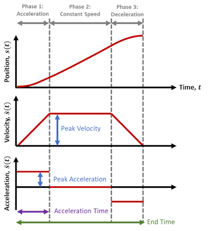

# URT Motion Planning Notes

### Parameters
- `MAX_VELOCITY`: $v_{max}$
- `MAX_ACCELERATION`: $a_{max}$
- `BRAKE_DECEL`: $d_{brake}$
- `current_velocity`: $v_n$
- $n$: current discrete time step

## Cyclic Sync Position (CSP) Trajectory planning
Position motion control using discrete time trapezoidal velocity profile (below). Implemented in `~/src/trajectory.cpp`.
  

### 1. Calculate position error, $E$

$e_n = r - y_n$
- $e_n$: Error
- $r$: Reference (final target position)
- $y_n$: Output (current position)

### 2. Calculate kinematic braking curve and desired velocity$

$v_{brake,n}$ is calculated to decelarate smoothly to zero degrees/s using following equation.  

$v_{brake,n} = \sqrt{2 \, d_{brake} \, |e_n|}$
- Note: sign of $v_{brake,n}$ must match sign of $E$

$v_{desired,n} = \text{min}(v_{max}, v_{brake,n})$

### 3. Calculate velocity error

Velocity error:   
$v_{e,n} = v_{desired,n} - v_n$

### 4. Calculate next velocity
Forward Euler integration:  
$v_{n+1} = v_n + \Delta t \, a_n$

Maximum allowed change in velocity:  
$\Delta v_{max} = a_{max} \Delta t$

$\implies v_{n+1} = v_n + v_{e,n}$, where $-v_{max} \leq v_{n+1} \leq v_{max}$

### 5. Update position
To find next position $\theta_{n+1}$, use trapezoidal rule for discrete integration.  
$\theta_{n+1} = \theta_n + \frac{v_n + v_{n+1}}{2} \, \Delta t$

> **Note**: $\theta_{n+1}$ is the target position for the next time step ($n+1$), which is different from the final target position, $r$.
